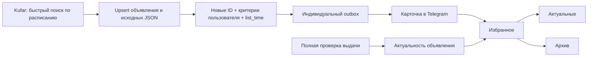

# Каталог и доставка квартир

`list_time` — время Kufar, `created_at` — первое обнаружение нашим сервисом,
`updated_at` — техническое обновление, `content_changed_at` — наблюдаемое изменение
данных, `last_seen_at` — последнее присутствие в выдаче. Значение `list_time` не
доказывает дату первой публикации. Состав полей и снимков — в [SOURCE_DATA.md](SOURCE_DATA.md).

Объявление видно при `is_source_active AND NOT is_hidden_by_admin`. Ручное скрытие
не сбрасывается скрейпером. Полная успешная сверка архивирует отсутствующие записи;
неоконченный обход, сбой сети или ошибка сохранения запрещают архивирование.
Физического удаления объявлений нет. Избранное ссылается на ту же запись и
автоматически показывает её в актуальных или в архиве.

Бот отправляет отдельные квартиры, появившиеся после включения наборов критериев.
Транзакционный outbox хранит каждую пару пользователь/ID и повторяет неудачную
доставку. Смена даты известного объявления не вызывает новой отправки.
Пользовательский сценарий, очистка избранного и эксплуатационные интервалы —
в [BOT_SEARCH.md](BOT_SEARCH.md).

Схемой управляет Alembic. Порядок локального и production-обновления, backup,
остановка писателей и однократные migrate/bootstrap — в [COMPOSE.md](COMPOSE.md).
